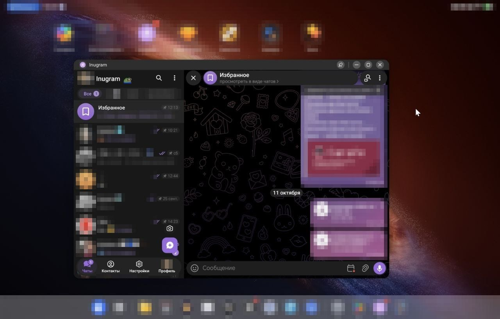

# Tablet Anywhere — плагин для Inugram

[English](README.md) | **Русский**

Плагин для [Inugram](https://github.com/teidesu/inugram): планшетный режим с двумя панелями (список чатов + чат) работает в split-screen, в оконном режиме и в портретной ориентации. Без плагина две панели бывают только на весь экран.



## Зачем

Стоковый Telegram для Android переключается на одну панель в двух случаях:
- приложение в режиме нескольких окон (`AndroidUtilities.isInMultiwindow`);
- «маленький планшет» в портрете.

Из-за этого на планшетах, складных телефонах и в десктоп-режиме (Samsung DeX, плавающие окна и т. п.) окно выглядит как телефон, даже если для двух панелей места хватает.

## Установка

1. Скачайте [`dist/tablet.inu.js`](dist/tablet.inu.js) (или из [Releases](../../releases)).
2. В Inugram откройте **Настройки → Плагины** и установите файл.
3. Разрешите запрошенные права (`unsafe.jvm`, `unsafe.xposed`): без них не перехватить код раскладки.

Если вид не поменялся сразу, один раз измените размер окна или поверните устройство.

## Настройки

| Опция | По умолчанию | Описание |
| --- | --- | --- |
| Две панели в окне и split-screen | вкл | Главный переключатель |
| Минимальная ширина окна | 600 dp | При меньшей ширине остаётся одна панель (левой нужно минимум 320 dp) |
| Планшет даже в узком окне | выкл | Включает планшетный режим, даже когда система считает окно «телефоном» (наименьшая сторона < 600 dp). Применяется после изменения размера окна, поворота или перезапуска |

## Как работает

Плагин использует xposed-хуки на скомпилированных routines, которые выполняются в UI-потоке:

- Пока выполняются `LaunchActivity.checkLayout()` и `onMeasure`/`onLayout` корневого layout, плагин временно ставит `isInMultiwindow = false` и заставляет `isSmallTablet()` вернуть `false`. После этого настоящие значения возвращаются, так что клавиатура и панель эмодзи видят реальный режим нескольких окон.
- Опционально `isTabletForce()` возвращает `true`, если окно достаточно широкое.

## Сборка из исходников

```bash
npm install
npx inu check
npx inu build   # -> dist/tablet.inu.js
```

## Совместимость

Проверено на Inugram с plugin API 1. Плагин опирается на внутренности Telegram, поэтому будущее обновление апстрима может его сломать. В таком случае откройте issue.

## Лицензия

MIT
